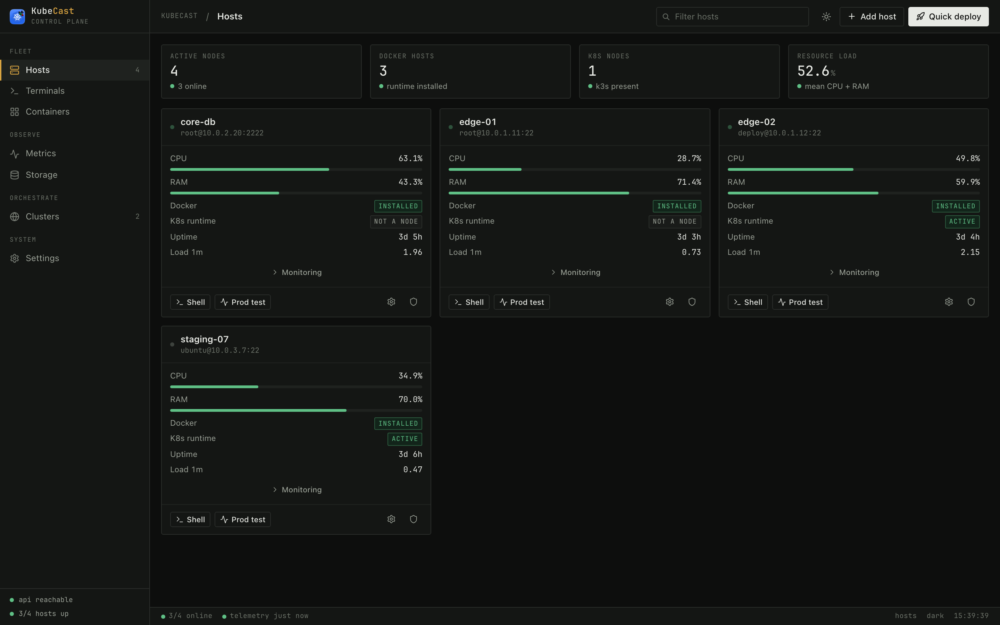

# KubeCast

KubeCast is a self-hosted web control plane for a fleet of Linux servers running
Docker and Kubernetes. It connects to hosts over SSH, so nothing has to be installed
on the target machines beyond the container runtimes themselves.

What it does:

- Keeps an inventory of servers and clusters, with live status and resource load.
- Opens interactive SSH terminals in the browser (WebSocket-backed).
- Deploys Dockerfiles and stops containers on a host.
- Reports system telemetry (CPU, memory, disk, network) and container stats.
- Generates and runs a VPS bootstrap template for a fresh server.
- Removes KubeCast-managed content from a host.



## Stack

- React 19 + TypeScript 5.8 + Vite 8 + Tailwind CSS 4 (frontend, `src/`)
- Express 4 backend bundled with esbuild (`server.ts` → `dist/server.js`)
- `ssh2` for SSH, `ws` for the terminal WebSocket

One Node process serves both the API and the built frontend. There is no desktop
shell and no native packaging step.

## Prerequisites

- Node.js 22 or newer, and npm
- SSH access to the Linux hosts you want to manage, with sudo for the deploy steps

## Local development

```bash
npm install
npm run dev
```

`npm run dev` runs `server.ts` through `tsx` with Vite in middleware mode, so the
frontend hot-reloads and the API is live on the same origin. Open
http://localhost:3000.

| Command | Purpose |
| --- | --- |
| `npm run dev` | Dev server with Vite middleware on port 3000 |
| `npm run build` | Build the frontend and bundle `server.ts` into `dist/server.js` |
| `npm start` | Serve the production build (`node dist/server.js`) |
| `npm run lint` | Typecheck with `tsc --noEmit` |
| `npm test` | Run the test suite with `tsx --test` |
| `npm run clean` | Remove `dist/` |

## Running in production

```bash
npm ci
npm run build
NODE_ENV=production node dist/server.js
```

`NODE_ENV=production` makes the server serve `dist/` as static files instead of
mounting Vite. Put it behind a reverse proxy that terminates TLS if the instance is
reachable from outside your network — the terminal WebSocket needs the proxy to
forward upgrade headers.

Environment variables:

| Variable | Default | Purpose |
| --- | --- | --- |
| `PORT` | `3000` | HTTP port to listen on |
| `DB_PATH` | `./db.json` | Where the server/cluster inventory is stored |
| `DIST_PATH` | `dist/` next to the bundled server | Static asset root |

The database is a single JSON file created on first run. It is git-ignored. Back it
up if you care about the inventory; it holds server credentials, so treat it as a
secret.

## Releasing

1. Set `version` in `package.json` to the new version (for example `0.1.0`).
2. Commit the change.
3. Tag it: `git tag v0.1.0`.
4. Push the tag: `git push origin v0.1.0`.

Pushing the tag is the only manual step. The `Release` workflow
(`.github/workflows/release.yml`) runs on `ubuntu-latest`, checks that the tag
matches `package.json`, typechecks, builds, and attaches
`kubecast-<version>-web.tar.gz` — containing `dist/`, `package.json` and
`package-lock.json` — to a GitHub Release with generated release notes. The SHA-256
of the archive is printed to the workflow run summary. The workflow can also be
started manually with `workflow_dispatch`, but it must be run against a version tag.

To deploy a release artifact:

```bash
tar -xzf kubecast-<version>-web.tar.gz
npm ci --omit=dev
NODE_ENV=production node dist/server.js
```

The release job needs write access to publish. If it fails with a permissions error,
set Settings → Actions → General → Workflow permissions to **Read and write**.

CI (`.github/workflows/ci.yml`) runs on pushes to `main` and on pull requests
targeting `main`: install, typecheck, build, test.

## License

See [LICENSE](LICENSE).
